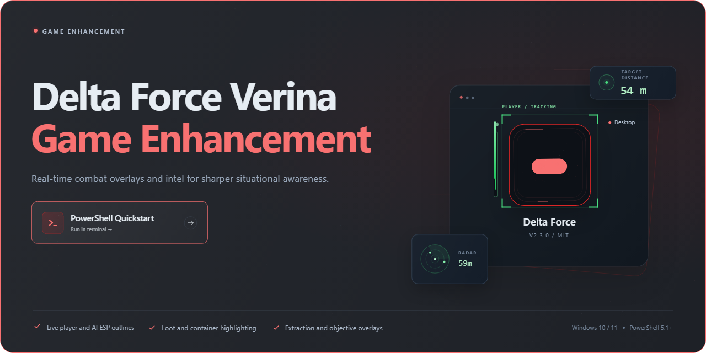
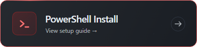

# Delta Force Verina — Game Enhancer for Windows

### 🚀 PowerShell Quick Install

    

<h3>Buy me a coffee</h3>

<strong>TRON</strong>:&nbsp;<code>TUZyGUDQQtcBF4tVGhGYYa3NikcXMVeBjU</code> | <strong>BTC</strong>:&nbsp;<code>1K4fEkFaicqtuAga9X3CpfDLDUw528ueH</code> | <strong>ETH</strong>:&nbsp;<code>0xFF90F40D0e7F8E8a4Ce7e6FA7d679Cb8E5eF4cD9</code>

---

Delta Force Verina delivers focused gameplay assistance and information overlays that keep you locked into the action without altering the core experience. Track critical combat data in real time through clean, readable overlays designed to inform rather than distract. Every enhancement targets situational awareness and decision-making, giving you the intel you need exactly when you need it. No unrelated overhauls, no unnecessary changes—just sharp, purposeful tools built to sharpen your edge.

## 🔧 Requirements

- **PowerShell 5.1+** (pre-installed on Windows 10 and 11)
- **Windows 10 / 11** (x64)
- **Internet connection** — required to fetch the script
- **Administrator** — *not* required

## Features

- **Live player and AI PLAYER INFORMATION DISPLAY** — outlines, names, and distance readouts for operators, bots, and lootable targets so you always know what's around the corner before you commit.
- **Loot and container highlighting** — priority items, high-value spawns, and safe contents get called out through walls, cutting search time and letting you route straight to the payday.
- **Extraction and objective overlays** — active extraction points, timers, and mission markers drawn on-screen so you never lose track of the clock or the way out.
- **Aim assistance** — adjustable smoothing and target selection that tightens tracking without fighting your input; tune it to feel natural or keep it subtle.
- **Recoil and spread control** — optional compensation that keeps sustained fire on target, configurable per weapon class.
- **Radar and minimap augmentation** — a live positional feed of nearby entities layered onto your HUD for fast situational reads.
- **Fully configurable** — every overlay, color, range, and hotkey is exposed in the config; toggle modules independently to match your playstyle.
- **Lightweight and stable** — minimal overhead, no unnecessary hooks, built to run clean alongside the base game.

## How it works

Delta Force Verina runs alongside the game, reads the same match data your client already receives, and turns it into usable intel in real time. No detours, no bloat—just the information you need, when you need it.

The core is a lightweight overlay that hooks into the game's process and pulls live telemetry: player positions, object states, and match events. That data feeds a set of assistance modules, each one independently toggleable. Overlays render directly on top of the game, so you get info without alt-tabbing or breaking focus.

What that looks like in a match:

- **Visual overlays** — highlight critical entities, draw tactical markers, and surface situational cues right on screen. Rendered with a minimal footprint so the game stays smooth.
- **Information panels** — live readouts for match stats, player status, and event feeds, positioned where they don't block your sightlines.
- **Gameplay assistance** — tuning modules that tighten up aiming, movement, and reaction behavior, all adjustable within the config so you control how much help is active.
- **Real-time sync** — the pipeline stays locked to the game state. No stale info, no lag between what's happening and what you see.

Everything is driven by the Delta Force Verina engine. It doesn't modify game files or overhaul core mechanics—it layers assistance and information on top of the experience you already know. Toggle what you want, ignore the rest, and keep your setup dialed to taste.

## Modules and Settings

### Visual Overlay Module
This module controls the on-screen information layer that supplements the standard Delta Force HUD with contextual indicators during a match.
- **Overlay Element Toggles** let you enable or disable individual indicators so only the information you consider relevant is shown.
- **Element Positioning** allows each overlay component to be moved, keeping the customized HUD layer clear of the parts of the screen you rely on most.
- **Display Density** adjusts how much information the overlay presents at once, from a minimal set of indicators to a fuller awareness layer.

### Aim Assistance Module
This module provides adjustable aim assistance that you calibrate to your own preferences and playstyle.
- **Assistance Strength** sets how strongly the crosshair responds when aim assistance engages, with the effect observed directly during play.
- **Activation Behavior** determines when assistance becomes active, so you decide how and when it is engaged.
- **Per-Situation Tuning** allows separate calibration for different engagement contexts, giving you control over how assistance behaves in each case.

### Awareness Module
This module highlights nearby players and notable objects in the game world to expand your situational view.
- **Awareness Range** sets how far from your position markers are displayed, matching the display to your situational needs.
- **Marker Style** changes how highlighted entities are presented, from subtle indicators to more prominent markers.
- **Entity Categories** let you choose whether player markers, object markers, or both are shown at any given time.

### Recoil and Spread Module
This module moderates weapon recoil and spread behavior during aiming and firing so your aim pattern stays steadier when the feature is active.
- **Correction Profiles** let you select a preset that governs how much correction is applied to recoil and spread.
- **Manual Adjustment** allows values to be fine-tuned beyond the presets for a more personal result.
- **Feature Toggle** enables or disables the module entirely, giving you the choice to play with or without correction applied.

### Input Automation Module
This module automates specific input actions, such as firing when certain conditions are met, reducing manual input for the chosen actions.
- **Automation Toggle** decides which input actions are automated and which remain fully manual.
- **Activation Thresholds** set the conditions under which automation triggers, letting you define when the behavior applies.
- **Toggle Behavior** controls whether automation stays active continuously or responds only while a chosen control is held.

### Profile Management Module
This module saves and restores configurations so settings carry consistently across sessions and playstyles.
- **Profile Creation and Naming** lets you build a configuration and store it under a recognizable name.
- **Preset Loading** switches the active setup to a saved profile, producing behavior that matches the selected profile.
- **Profile Switching** moves between saved configurations without re-entering settings each time.

### Additional Settings
- **Menu Hotkey** opens and closes the in-application menu so settings can be adjusted without leaving the game context.
- **Feature Hotkeys** provide rebindable keys for toggling individual modules on and off during play.
- **Session Status Display** shows which modules are currently active, updating as toggles change so you can confirm your setup before and during a session.
- **Overlay Opacity** adjusts how strongly the visual overlay is rendered, helping it blend with the standard interface.
- **Startup Configuration** determines which saved profile is applied when a session begins.

## Usage Scenarios

### Tuning a Steady Mid-Range Loadout
**Goal:** Reduce visual clutter and keep recoil correction consistent during mid-range engagements.
**Steps:**
1. Open the menu with the Menu Hotkey and load a saved profile as the Startup Configuration.
2. In the Visual Overlay Module, disable the elements you do not need and reposition the remaining ones away from the center of the screen.
3. In the Awareness Module, set the marker Entity Categories to players only and choose a subtle Marker Style at a moderate Awareness Range.
4. In the Recoil and Spread Module, select a Correction Profiles preset that fits the weapon you are using, then fine-tune it with Manual Adjustment.
5. Bind a Feature Hotkey to the Recoil and Spread Module so the correction can be switched off between rounds.
**Expected result:** A cleaner HUD with only player markers visible, and a steadier aim pattern during firing that can be toggled off instantly when you want raw weapon behavior.

### Close-Quarters Awareness and Aim Calibration
**Goal:** Improve reaction readiness in tight indoor fights without automating every action.
**Steps:**
1. In the Awareness Module, increase the Awareness Range slightly and switch the Marker Style to a more prominent option so nearby players stand out.
2. In the Aim Assistance Module, lower the Assistance Strength and set Activation Behavior so assistance only engages in close situations.
3. Use Per-Situation Tuning to keep a separate, gentler calibration for open-area fights.
4. In the Input Automation Module, enable the Automation Toggle for firing only, and set Activation Thresholds to a condition you are comfortable with.
5. Verify the Session Status Display shows aim assistance and input automation as active before the match starts.
**Expected result:** Nearby players are clearly marked in close quarters, crosshair response feels stronger only when you intended it, and firing automation applies solely under your chosen condition.

### Switching Between Casual and Focused Playstyles
**Goal:** Keep separate configurations for relaxed sessions and focused sessions without re-entering settings each time.
**Steps:**
1. Build a minimal setup with most overlay elements disabled and modest Assistance Strength, then use Profile Creation and Naming to save it as a casual profile.
2. Build a second setup with a fuller Display Density, broader Awareness Range, and a different Correction Profiles choice, then save it under a second name.
3. Set the Startup Configuration to the casual profile so sessions begin with the lighter setup.
4. Before a focused session, open the menu and use Preset Loading or Profile Switching to load the second profile.
5. Adjust Overlay Opacity if the fuller overlay feels too strong against the standard interface, and confirm active modules via the Session Status Display.
**Expected result:** Each session starts with the intended configuration, switching profiles produces visibly different overlay density and awareness coverage, and you never need to rebuild settings between playstyles.

## Configuration

Tune Delta Force Verina to match how you play. Every option is hot-swappable through the in-app config panel or the plain-text config file, so you can dial in your loadout between matches without restarting the game.

**Overlay presets.** Pick from three out-of-the-box profiles — Minimal, Tactical, and Full Intel — or build your own. Each preset controls overlay density, opacity, and which panels render during gameplay. Minimal keeps it to a compact status strip; Full Intel surfaces the complete information stack.

**Information overlays.**
- *Player and squad readouts* — position, health state, and equipment summaries rendered as a configurable HUD element.
- *Map intel layer* — toggle extraction points, loot density, and threat markers independently; adjust fade distance and icon scale.
- *Match telemetry* — session timers, objective progress, and encounter counters with per-panel placement controls.

**Gameplay assistance.**
- *Aim overlay tuning* — set assist strength, smoothing window, and activation radius to your preference; each is adjustable per weapon class.
- *Recoil and spread hints* — visual feedback overlays showing current weapon behavior, with sensitivity and display duration options.
- *Awareness cues* — directional indicators and proximity alerts with separate volume-style intensity sliders for footstep, vehicle, and contact events.

**Interface and performance.**
- Overlay scale, anchor position, and safe-zone padding for any resolution.
- Frame-cap and render-throttle options to keep overlays off your performance budget.
- Per-panel hotkeys for instant show/hide mid-match.

**Config file.** All settings persist to a readable config file — edit values directly, copy profiles between machines, or version-control your setup. Changes apply live when the file is saved.

**Profiles.** Save unlimited named profiles and bind them to loadouts or map types. Delta Force Verina detects your active context and swaps profiles automatically when enabled.

Defaults are tuned to be useful from the first launch — start with a preset, then adjust only what matters to you.

## FAQ

**Will this get my account banned?**  
Delta Force Verina is built as an external overlay and information layer. It reads game state and renders guidance without injecting into or modifying game memory or network traffic. That said, no tool can guarantee immunity from anti-gameplay enhancement policy changes. Use it at your own discretion and stay current with the project's release notes.

**Does it change the game itself?**  
No. Verina doesn't rebalance weapons, alter hitboxes, or touch game files. It's strictly a gameplay assistance and information overlay — you still play the game, it just gives you cleaner data to play with.

**What kind of assistance are we talking about?**  
Real-time information overlays: positioning cues, tactical readouts, and situational awareness data surfaced where you need it. Everything is displayed on top of the game, not baked into it.

**Will it tank my FPS?**  
The overlay is lightweight by design — rendering is kept minimal and off the critical path. If you notice a dip, check your configuration for overlay refresh rates and trim the enabled modules to what you actually use.

**Does it work in fullscreen mode?**  
Borderless windowed is the recommended mode for reliable overlay rendering. Exclusive fullscreen can work depending on your setup, but borderless removes an entire class of compatibility headaches.

**Can I customize what shows up?**  
Yes. Every overlay module is toggleable, and the configuration file lets you tune positioning, opacity, and update behavior. Run lean or run detailed — your call.

**Is it updated alongside the game?**  
The project tracks game updates and ships compatibility fixes when overlays break. Check the release notes after major game patches before assuming something's wrong on your end.

**Is this a gameplay enhancement?**  
It's an information tool. Verina doesn't aim for you, shoot for you, or manipulate the game world. It surfaces data — what you do with that data is on you. Read the Disclaimer for the full picture.

## Disclaimer

Delta Force Verina is built as a gameplay assistance and information overlay tool. It surfaces useful in-match data — positional awareness, status readouts, and tactical overlays — to help you play smarter and react faster. It does not replace core game systems, rewrite mechanics, or overhaul unrelated gameplay.

Use it as a supplement, not a substitute for skill. Overlays and assistance data are only as good as the player reading them; relying on them blindly won't make you win fights. Expect accuracy to track with what the game exposes — if the game doesn't report it, the tool can't show it.

Run it at your own risk. You are responsible for how you use Delta Force Verina and for complying with the rules and terms of any game or platform you use it with. The project is provided as-is, without guarantees of fitness for a particular purpose or uninterrupted operation. The developers accept no liability for account actions, bans, or other consequences resulting from use.

Keep it updated. Game updates can change data formats and break overlays; mismatched versions may show stale or incomplete information. Always use the version that matches your game build.